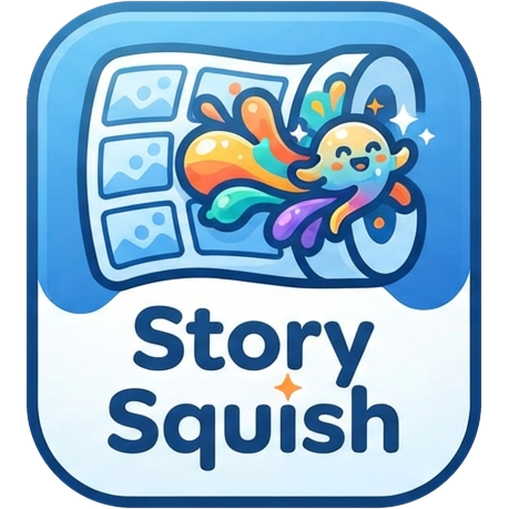

<p align="center"></p>

# StorySquish

<a href="https://www.buymeacoffee.com/storysquish"></a>

A desktop scene board for planning and drafting novels. Lay out scenes as
cards, track their status, act, point-of-view character, location and story
day, write each scene's prose, and keep characters, relationships and
locations alongside. Built in Rust with [egui/eframe](https://github.com/emilk/egui).

**Use the desktop app for writing you care about.** The
[browser version](#browser-version) is there to try StorySquish without
installing anything, or for a quick look at a board from a machine without
the app.

## Desktop app or browser?

The two share features and the board's JSON format, but not where your work
lives:

|                         | Desktop app                                  | Browser version                                   |
| ----------------------- | -------------------------------------------- | ------------------------------------------------- |
| Where the board lives   | A JSON file on disk ([Files](#files))        | The browser's `localStorage`, unless linked to a file |
| Survives clearing site data | Yes                                       | Only with a linked file or an export              |
| Crash-safe writes       | Temp file + rename on every save             | Depends on the browser                            |
| Rolling backups         | 30 copies on disk, next to the board         | 30 versions in IndexedDB, same browser only        |
| Syncing between devices | Any synced folder, every OS                  | Linked file in Chrome and Edge on desktop only; permission must be re-granted each visit |
| GitHub backup           | Pushes 5 s after edits and on quit           | At most every five minutes, and on leaving the page |
| GitHub token            | Separate file readable only by you (`0600`)  | The browser's `localStorage`                      |

"Clear browsing data" removes `localStorage` and IndexedDB along with the
board, and browsers that refuse the page's request for persistent storage may
evict them under storage pressure. The desktop app keeps everything in
ordinary files you can see, copy and back up.

## Install

Each [release](https://github.com/story-squish/storysquish/releases) has:

- macOS: `StorySquish-<tag>-macos-universal.pkg`, which installs
  `StorySquish.app` into `/Applications` for Apple silicon and Intel. The
  package is not notarized, so macOS blocks it the first time; allow it in
  **System Settings → Privacy & Security → Open Anyway**.
- Windows: `StorySquish-<tag>-windows-x86_64.zip` with a standalone
  `StorySquish.exe` (no Visual C++ runtime needed). Unzip it anywhere and run
  it; SmartScreen may ask you to confirm the first time.
- Linux: build from source (below).

## Build from source

```sh
cargo run -r                      # open the default board
cargo run -r -- path/to/board.json # open a specific board file
make install                      # release build, installed for the current OS
```

`make install` puts the app where each OS expects it:

- macOS: `/Applications/StorySquish.app` (override with `APP_DIR=~/Applications`).
- Linux: `~/.local/bin/storysquish` plus a launcher entry in
  `~/.local/share/applications` (override with `PREFIX=/usr/local`).

`make uninstall` removes the same files.

On Linux, eframe needs these system libraries:

```sh
sudo apt-get install libxcb-render0-dev libxcb-shape0-dev \
  libxcb-xfixes0-dev libxkbcommon-dev libssl-dev
```

## Features

- Scene cards with title, summary, status (Outline, Draft, Revision, Final,
  Archived), act (I–III), POV character, location and story day
- **Write** view: a prose editor per scene with previous/next navigation and
  scene and manuscript word counts
- **Timeline** view: scenes in story-day order, so flashbacks and parallel
  threads show up next to their place in the story's chronology
- **Relationships** view: a graph of directed, labelled relationships between
  characters (added in the character inspector)
- Characters with role, gender, goal and notes; locations with notes
- Several boards, one per novel: **New** starts a board in its own file next
  to the current one, named after its title; the file is renamed to follow
  later title changes unless you gave it a name of your own. **Open → Local** lists the last eight boards you
  switched away from and works offline; **Open → Cloud…** lists boards
  backed up to GitHub
- Reorder scenes by drag or keyboard, characters and locations by keyboard or
  buttons
- Search (including prose) plus filters by status, act and POV
- Undo/redo across all board edits
- Autosave after every change, rolling backups, and pick-up of changes synced
  in from other devices (see [Files](#files))
- Optional backup to a private GitHub repository, with every version
  restorable (see [GitHub backup](#github-backup))
- Import/export the board as JSON; export an outline or the manuscript as
  Markdown (archived scenes are left out; outline scenes keep their board
  numbers)
- Ten color schemes, light and dark
- Spellcheck in prose, summaries and notes, with suggestions on right-click.
  English (US) and English (UK) are built in; German, Spanish, French and
  Russian download on first use from Settings. Any Hunspell dictionary
  installed on the computer is offered too. Character and location names
  always count as correct.

## Keyboard shortcuts

`Cmd` is `Ctrl` on Linux and Windows.

| Shortcut                     | Action                         |
| ---------------------------- | ------------------------------ |
| `Cmd+N`                      | New scene                      |
| `Cmd+D`                      | Duplicate selected scene       |
| `Cmd+F`                      | Focus search                   |
| `Cmd+Z` / `Cmd+Shift+Z`      | Undo / redo                    |
| `Alt+←` / `Alt+→`            | Move selected scene            |
| `Alt+↑` / `Alt+↓`            | Move selected character or location |
| `Delete` / `Backspace`       | Delete selected scene          |
| `Esc`                        | Close inspector                |

Undo, redo, move, delete and `Esc` act on the board only when no text field
has focus, so they keep their usual meaning while typing.

## Files

| What     | Location                                                        |
| -------- | --------------------------------------------------------------- |
| Board    | The path given on the command line, else the one chosen in Settings, else `board.json` in the platform data dir (below) |
| Backups  | `<board>-backups/` next to the board file, e.g. `board-backups/` |
| Settings | `$XDG_CONFIG_HOME/storysquish/settings.json`, falling back to `~/.config/storysquish/settings.json` on every platform |
| GitHub token | `github-token` next to `settings.json`, readable only by you |
| Dictionaries | Hunspell `.aff` + `.dic` pairs in `dictionaries/` next to `settings.json` (where downloaded ones are saved), then `~/Library/Spelling` and the usual system `hunspell`/`myspell` dirs |

Platform data dir:

- macOS: `~/Library/Application Support/storysquish/`
- Linux: `~/.local/share/storysquish/`
- Windows: `%APPDATA%\storysquish\data\`

Writes go through a temp file and rename, so a crash never leaves a
half-written board. Before the first save of a session, and every 30 minutes
of editing after that, the board file is copied into the backups directory;
the newest 30 copies are kept. Import, **Recover from local…** and loading
from GitHub first copy the current board there too, tagged
`-before-import`, `-before-recover` or `-before-github`. Each tag keeps its
own newest 30, so routine backups never push out a conflict copy, and files
in the folder that the app didn't write are left alone.
**Settings → Recover from local…** loads one (undoably).

To use a board on several computers, use **Settings → Move…** to put it in a
folder synced by iCloud Drive, Dropbox, OneDrive or Syncthing, and
**Settings → Open…** to pick it on the other machines; the choice is
remembered. The app checks the file every two seconds and reloads it when it
changed elsewhere and there are no unsaved edits (the reload can be undone).
If it changed while there were unsaved edits, the local version is saved and
the other one is kept as a `-conflict` backup. If the board can't be parsed at startup, it is moved to
`board.json.corrupt` and the app starts with an empty board instead of
overwriting it on the next autosave.

Data and config left by the app's earlier names (`story-planner`,
`novel-planner`) are moved over on first launch, unless a `storysquish`
directory already exists.

## GitHub backup

Off until you connect a token. Each board is backed up to its own **private**
repository, so only your account (and anyone you add as a collaborator) can
read it; unlike a secret gist, a leaked link reveals nothing.

If you already use GitHub: in **Settings → GitHub backup**, paste a
[fine-grained token](https://github.com/settings/personal-access-tokens/new)
with access to *All repositories* and the repository permissions
*Administration: read and write* (to create and describe the repositories) and
*Contents: read and write*, or a classic token with the `repo` scope, and
click **Connect**. A token made for the old gist backup lacks these
permissions; replace it.

### Setting it up for the first time

New to GitHub? GitHub is a website that stores files and keeps every earlier
version of them. StorySquish uses it as an off-site copy of your board, so
your novel survives a lost or broken computer. It is free, and takes about
five minutes to set up once.

1. **Create a GitHub account.** Go to <https://github.com/signup>, enter an
   email address, a password and a username, and confirm the email GitHub
   sends you. The free plan is all you need.
2. **Create a token.** A token is a password just for StorySquish: it lets
   the app save your boards without knowing your real password, and you can
   revoke it at any time. While signed in to GitHub, open
   <https://github.com/settings/personal-access-tokens/new> (or click your
   profile picture, then **Settings → Developer settings → Personal access
   tokens → Fine-grained tokens → Generate new token**) and fill in:
   - **Token name**: anything you'll recognise, such as `StorySquish`.
   - **Expiration**: how long the token works. When it runs out, backups stop
     with an error and you repeat steps 2 and 3. A year is a reasonable
     choice.
   - **Repository access**: choose **All repositories**. StorySquish creates
     a new repository for each board, which a token limited to selected
     repositories cannot do.
   - **Permissions**: under **Repository permissions**, set
     **Administration** to **Read and write** and **Contents** to **Read and
     write**. Leave everything else as it is; GitHub adds **Metadata:
     Read-only** by itself.

   Click **Generate token**, then copy the token (it starts with
   `github_pat_`). GitHub shows it only once; if you lose it, delete it on
   the same page and generate a new one.
3. **Connect StorySquish.** In the app, click **Settings**, paste the token
   into the **GitHub token** field under **GitHub backup**, and click
   **Connect**. The token is kept in a file on your computer that only your
   user account can read.
4. **Create the backup repository.** Edit the board, or click **Back up
   now**. A **Save to a GitHub repository** window suggests a name such as
   `storysquish-dune`; click **Create**. The repository is private: nobody
   but you can see it, even if they know its name.

From then on, every change is backed up automatically a few seconds after you
stop typing. To check, click **Open** next to the repository name in
Settings: your board appears on GitHub as `storysquish-board.json`, and its
**History** lists every backup. **Settings → Restore from GitHub…** brings
back any of them.

Being offline is not an error. The header shows *offline*, edits keep
saving on your computer, and backups resume on their own once GitHub is
reachable again, even if you close StorySquish in the meantime: the next
launch backs up whatever did not make it. A board with edits that never
reached GitHub is not replaced by the older copy when you open it from the
cloud.

If something else goes wrong, the error appears under **GitHub backup** in
Settings:

- *the token is invalid or expired*: the token ran out or was deleted, or a
  character was lost when pasting. Click **Disconnect**, make a new token,
  and connect again. Your repository and its history are kept.
- *the token lacks the Contents or Administration permission*: a permission
  from step 2 is missing. Open the token on GitHub's token page, click
  **Edit**, and add it; the token text stays the same, so the next backup
  works without reconnecting.

To use the same backup on a second computer, install StorySquish there,
repeat step 3 (the same token works, or make another one), and paste the
repository's name, e.g. `yourname/storysquish-dune`, into the repository field
in Settings instead of creating a new one.

### How it works

- **Back up now** commits the board as `storysquish-board.json`. Before the
  first push the app suggests a private repository named after the board,
  e.g. `storysquish-dune` (numbered if your account already has one), and
  creates it only once you confirm or edit the name; later pushes add commits
  to it. Cancelling stops automatic backup from asking again until the next
  session. If the linked repository has been deleted, the next backup offers
  to create it again.
- **Back up automatically**, in the desktop app, pushes 5 seconds after you
  stop editing, right away when you edit the title or move focus to another
  field or window, and once more when you quit. The web version pushes at most
  every five minutes while the board changes, and when you leave the page.
- **Restore from GitHub…** lists the last 30 commits; restoring can be undone.
- In the desktop app each board file gets its own repository, so every novel
  keeps a separate history, and the restore list is headed by that board's
  title. Moving the board file keeps its repository; opening another board
  switches to that board's repository.
- Changing the title renames the repository to `storysquish-` and the title
  on the next push, numbering the name if it is taken. Opening a board whose
  repository name lacks the `storysquish-` prefix adds it (`dune` becomes
  `storysquish-dune`); in the web version that happens on page load. GitHub
  redirects old names, so other devices keep backing up to them.
- To back up to the same repository from another device or browser, paste
  `owner/name` or its URL into the repository field there. Clear the field to
  be offered a new repository next time.
- The app refuses to push to a public repository, so a mistyped or pasted
  link cannot publish a board.
- **Disconnect** forgets the token; the repository stays on GitHub.

Boards previously backed up to gists are not copied over. Delete those gists
on GitHub if you no longer want them reachable by link; their revision history
is readable by anyone with the URL until you do.

The desktop app keeps the token in a separate `github-token` file (mode
`0600`) so `settings.json` can be synced or shared safely. The web version
keeps it in the browser's `localStorage`.

## Browser version

Published at <https://story-squish.github.io/storysquish/> from
[`docs/index.html`](docs/index.html). Boards move to the desktop app through
Export and Import, or by pointing both at the same file.

It keeps the board in `localStorage` and the last 30 versions in IndexedDB
(**Settings → Restore backup…**), and asks the browser for persistent storage.
In Chrome and Edge on desktop, **Settings → Save to file… / Open file…** links
the board to a JSON file, for example in a synced folder: every change is
written to it and changes synced in are picked up, with the same conflict
handling as the desktop app. Browsers drop file permission between visits, so
a "Reconnect file" button appears until clicked. Without a linked file, a
"Back up" button appears when the board has not been exported for a week;
export regularly, or move to the desktop app.

## Development

```sh
make check   # cargo fmt --check, clippy -D warnings, cargo test
make format
make lint
make test
```

CI runs the same three checks on every pull request. Clippy `pedantic` is
enabled and `unsafe` code is forbidden. Publishing a GitHub release builds the
macOS package and Windows zip and attaches them to it
([`release.yml`](.github/workflows/release.yml)). UI tests in [`tests/ui.rs`](tests/ui.rs)
drive the app headlessly with `egui_kittest`.

### Layout

| Module                                   | Responsibility                                   |
| ---------------------------------------- | ------------------------------------------------ |
| [`model`](src/model.rs)                  | Board, scenes, characters, locations, relationships; JSON schema |
| [`app`](src/app.rs)                      | egui UI, shortcuts, dialogs                      |
| [`history`](src/history.rs)              | Snapshot-based undo/redo                         |
| [`storage`](src/storage.rs)              | Board load/save, atomic writes, backups, export names |
| [`settings`](src/settings.rs)            | Color scheme, board location, recent boards, repo links, dictionary |
| [`github`](src/github.rs)                | GitHub backup client, token file, background requests |
| [`outline`](src/outline.rs)              | Markdown outline and manuscript export           |
| [`spelling`](src/spelling.rs)            | Dictionaries, word splitting, spellchecker       |
| [`theme`](src/theme.rs)                  | Color schemes and palettes                       |
| [`migration`](src/migration.rs)          | Move data from pre-rename directories            |
